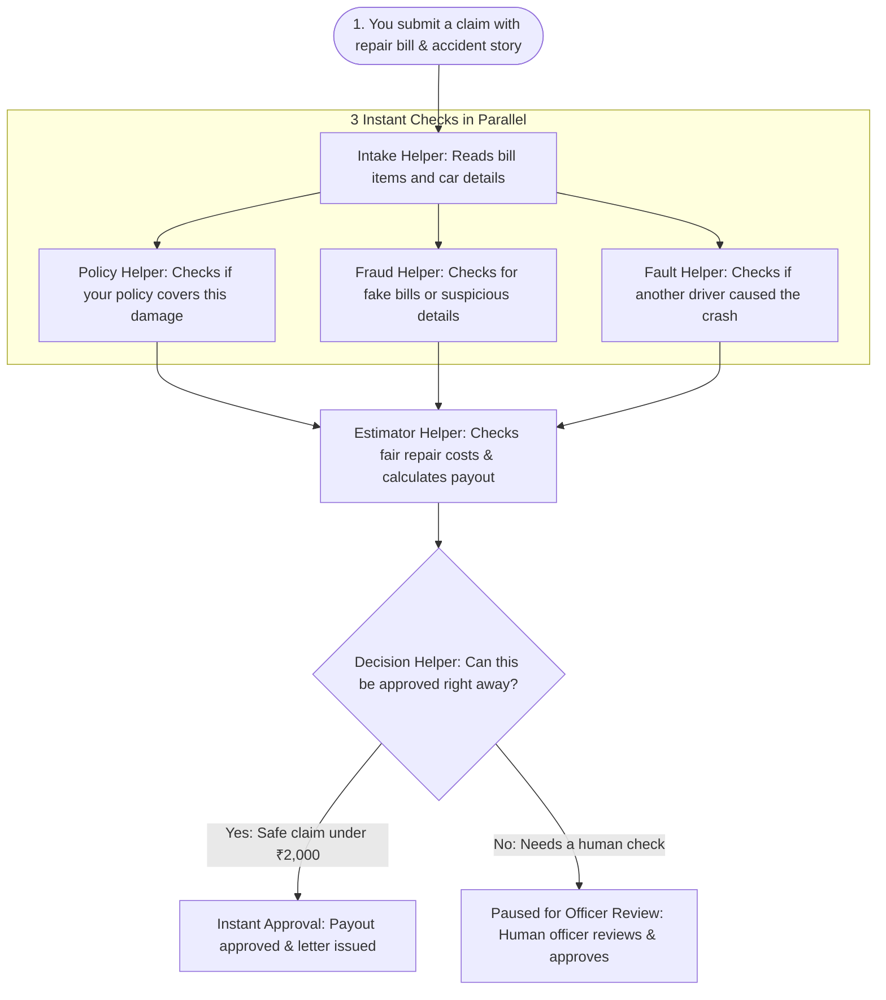

# ClaimFlow AI

### Smart AI System for Car Insurance Claims and Fraud Detection

[](https://www.python.org/)
[](https://github.com/langchain-ai/langgraph)
[](https://fastapi.tiangolo.com/)
[](https://react.dev/)
[](https://www.typescriptlang.org/)
[](https://tailwindcss.com/)
[](LICENSE)

---

## What is ClaimFlow AI?

When you file a car insurance claim after an accident, insurance companies usually take **3 to 5 days** to review documents, verify repair bills, and calculate your payout.

**ClaimFlow AI** uses a team of 6 specialized AI helpers to read repair bills, check insurance rules, detect fraud, and settle claims in **under 5 seconds**:

- **Instant Approval:** Normal claims under ₹2,000 with genuine repair bills are approved immediately.
- **Officer Review:** Suspicious claims, high repair bills, or cases where the other driver was at fault are paused for a human claims officer to check and sign off.
- **Accurate Math:** Exact payout math is calculated by fixed formulas — the AI never guesses dollar or rupee amounts.
- **Made for India:** Shows all amounts in Indian Rupees (`₹`), uses Indian number style (like `₹2.5 lakh`), dates in `DD/MM/YYYY`, and times in `IST`.
- **Works 100% Free & Offline:** Comes with a built-in test AI, so you can run the whole app on your computer without paying for any API keys.

---

## How It Works



---

## The 6 AI Helpers

| # | Helper Name | What It Does |
|:---:|:---|:---|
| **1** | **Intake Helper** | Reads the uploaded repair bill or PDF, lists each replaced part and labor cost, and checks that the bill totals add up correctly. |
| **2** | **Policy Helper** | Reads your insurance policy document to confirm the accident date falls within your active policy and is covered. |
| **3** | **Fraud Helper** | Gives a safety risk score from 0 to 100. Catches red flags like claims filed right after buying insurance or mismatched repair bills. |
| **4** | **Fault Helper** | Checks police reports and accident stories to see if another driver or delivery truck caused the crash, so the company can recover costs. |
| **5** | **Estimator Helper** | Compares repair prices against standard market rates, removes overcharged amounts, subtracts your deductible, and calculates the final payout. |
| **6** | **Decision Helper** | Makes the final call: instantly approves clean, low-cost claims, or sends high-cost and suspicious claims to a human officer. |

---

## Easy 3-Step Setup

You do **not** need any paid API keys or complicated setup. Everything runs locally on your computer.

### Step 1: Download the Project
```bash
git clone https://github.com/yashpatilmali/ClaimFlow.git
cd ClaimFlow
```

### Step 2: Install Everything
```bash
# This installs all Python and frontend packages automatically
python scripts/dev.py setup
```

### Step 3: Start the App
```bash
# Starts both the backend and web interface together
python scripts/dev.py start
```

Now open **[http://localhost:5173](http://localhost:5173)** in your browser!

---

## Using Real AI (Optional)

By default, ClaimFlow runs on **MockLLM** (a built-in offline simulation that costs ₹0). 

If you want to use live AI to read your own custom documents, you can add a free API key from **Google Gemini** or **Groq**:

1. Copy `.env.example` to `.env`.
2. Add your key and set `MOCK_LLM=false`:

```env
# If using Google Gemini (Recommended)
GEMINI_API_KEY=your_gemini_api_key_here
MOCK_LLM=false

# OR if using Groq (Super fast)
GROQ_API_KEY=your_groq_api_key_here
MOCK_LLM=false
```

---

## Ready-to-Test Sample Scenarios

The app includes 19 ready-to-test sample cases you can try with one click in the **Test Lab**:

| Case | What Happened | What the AI Does |
|:---|:---|:---|
| **Clean Bumper Repair** | Small parking scratch, repair bill is ₹850 | **Approved in seconds** |
| **Street Racing Crash** | Car crashed during an illegal street race | **Paused** (Street racing is not covered) |
| **Inflated Repair Bill** | Small mirror damage, but invoice asks for ₹6,800 roof replacement | **Paused** (Flagged for fraud investigation) |
| **Truck Rear-End** | Stopped at red light and hit by a delivery truck | **Paused** (Sent for other driver recovery) |
| **Under Deductible** | Repair bill is ₹250, but policy deductible is ₹500 | **Approved with ₹0 payout** |
| **High Repair Cost** | Repair costs exceed ₹2,000 threshold | **Paused** for claims officer sign-off |

---

## Helpful Commands

```bash
python scripts/dev.py test       # Runs all 22 backend automated tests
python scripts/dev.py smoke      # Runs a full end-to-end check of all cases
python scripts/dev.py reset      # Cleans and resets the database back to initial state
```

---

## Technology Behind the App

- **Python & FastAPI:** Fast, modern backend service.
- **LangGraph:** Orchestrates the 6 AI helpers and pauses claims safely for human sign-off.
- **React & Tailwind CSS:** Clean, responsive web dashboard that works on both desktop and mobile.
- **AI Models:** Google Gemini, Groq, and built-in offline MockLLM.

---

## License

This project is licensed under the [MIT License](LICENSE).
